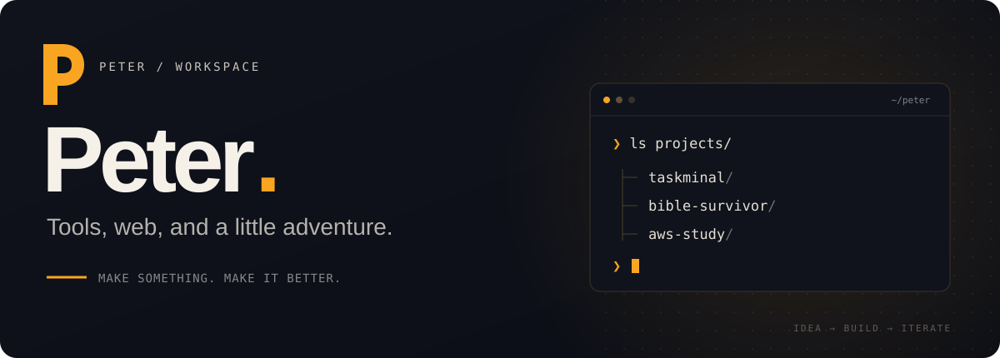
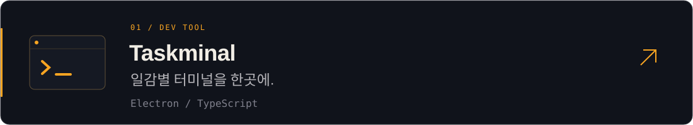

  

개발할 때 필요한 도구, 배움을 돕는 웹, 직접 플레이하는 게임을 만듭니다.  
아이디어를 작게 시작하고, 직접 써 보면서 다듬습니다.

 

### Selected work

 

**Also building** · [Kotlin 블로그 프로젝트 ↗](https://github.com/petercorders/blog)

---

<code>~/toolbox</code> &nbsp; TypeScript · Electron · Kotlin · Unity
