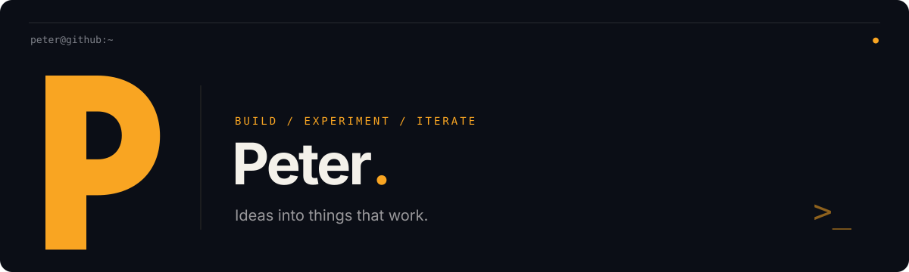

<p align="center">
  
</p>

### 만들고, 실험하고, 기록합니다.

개발 도구부터 웹 서비스와 게임까지, 아이디어를 직접 구현합니다.  
작게 시작해서, 직접 써 보고, 계속 다듬습니다.

<br />

### `~/projects`

| Project | What I'm building | Stack |
| :--- | :--- | :--- |
| **[Taskminal](https://github.com/petercorders/taskminal)** | 일감별로 터미널 세션을 묶어 쓰는 macOS 터미널 | `Electron` `TypeScript` |
| **[Bible Survivor](https://github.com/petercorders/Bible-Survivor)** | 성경 소재의 2D 픽셀 서바이벌 게임 | `Unity` |
| **[AWS Study](https://github.com/petercorders/AWS)** | AWS SAA-C03 학습 및 문제 풀이 사이트 | `JavaScript` |
| **[blog](https://github.com/petercorders/blog)** | Kotlin으로 만드는 블로그 프로젝트 | `Kotlin` |

<br />

### `~/toolbox`

`TypeScript` · `Electron` · `Kotlin` · `Unity`

<br />

```text
peter@github:~ $ next
Keep building.
```
