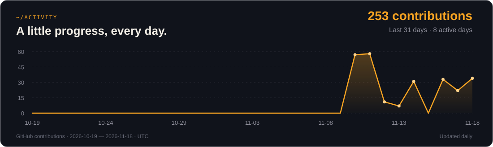

  

개발할 때 필요한 도구, 배움을 돕는 웹, 직접 플레이하는 게임을 만듭니다.  
아이디어를 작게 시작하고, 직접 써 보면서 다듬습니다.

 

## Taskminal

**프로젝트를 바꿔도, 하던 자리 그대로.**

터미널 탭·분할·AI 대화를 일감별로 묶는 데스크톱 작업 공간을 만듭니다.  
여러 프로젝트를 오갈 때 터미널과 작업 맥락을 다시 찾는 수고를 줄입니다.

[**다운로드 ↗**](https://taskminal.petercoders.com/#downloads) &nbsp; · &nbsp; [사용 가이드](https://taskminal.petercoders.com/docs/) &nbsp; · &nbsp; [소스 코드](https://github.com/petercorders/taskminal) &nbsp; · &nbsp; [릴리스 노트](https://github.com/petercorders/taskminal/releases/latest)

실제 앱에서 촬영한 데모 작업 공간 · 화면 버전 v0.1.0

- **일감별 작업 공간** — 폴더마다 터미널 탭과 분할을 묶어 관리합니다.
- **AI와 같은 화면에서 작업** — 설치한 Claude·Codex CLI와 본인 계정으로 대화를 이어 갑니다.
- **파일·변경 검토까지 연결** — 파일 탐색과 Git 변경 검토를 앱 안에서 이어 갑니다.

`Electron` `TypeScript` · macOS / Windows·Linux 베타  
설치 파일은 다운로드 페이지에서 운영체제에 맞게 고를 수 있습니다.

 

### More projects

| Project | What I'm building |
| :--- | :--- |
| [**Bible Survivor ↗**](https://github.com/petercorders/Bible-Survivor) | 성경 속 이야기를 2D 픽셀 서바이벌로 만드는 Unity 게임 |
| [**AWS Study ↗**](https://github.com/petercorders/AWS) | AWS SAA-C03 학습 및 문제 풀이 사이트 · JavaScript |
| [**blog ↗**](https://github.com/petercorders/blog) | Kotlin으로 만드는 블로그 프로젝트 |

 

### Activity

---

<code>~/toolbox</code> &nbsp; TypeScript · Electron · Kotlin · Unity
